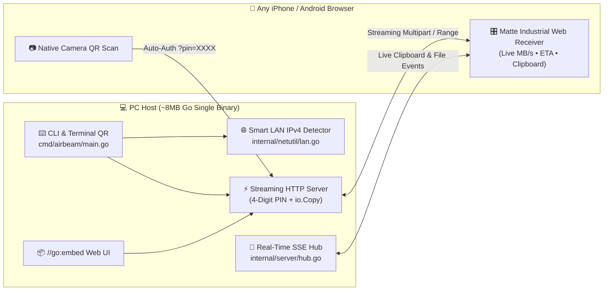

<a id="readme-top"></a>

<!-- CUSTOM 60FPS ANIMATED HERO BANNER -->
<div align="center">
  <a href="https://github.com/a1n2a3s6/airbeam-drop/releases">
    
  </a>

  <br />
  <br />

  <!-- LIVE GITHUB STATS & RELEASE BADGES -->
  <p>
    <a href="https://github.com/a1n2a3s6/airbeam-drop/releases">
      
    </a>
    <a href="https://github.com/a1n2a3s6/airbeam-drop/stargazers">
      
    </a>
    <a href="https://github.com/a1n2a3s6/airbeam-drop/network/members">
      
    </a>
    
    
  </p>

  <!-- QUICK NAVIGATION -->
  <p>
    <a href="#-live-lan-transfer-preview"><strong>🎬 How It Beams</strong></a> &nbsp;│&nbsp;
    <a href="#-why-airbeam"><strong>🎯 Why AirBeam</strong></a> &nbsp;│&nbsp;
    <a href="#-bento-feature-suite"><strong>⚡ Features</strong></a> &nbsp;│&nbsp;
    <a href="#-architecture"><strong>🏗️ Architecture</strong></a> &nbsp;│&nbsp;
    <a href="#-download--usage"><strong>📦 Download</strong></a>
  </p>
</div>

---

> [!IMPORTANT]
> **Stop emailing yourself or compressing 4K videos through WhatsApp.**
> **AirBeam** is a single **~8 MB Go binary** for **Windows, Linux, and macOS** that turns your local Wi-Fi into an instant **AirDrop + Live Clipboard Sync** with any **iPhone or Android** phone. Scan the Terminal QR Code — **zero phone apps to install, zero internet required, zero compression, full 80+ MB/s LAN speed**.

---

## 🎬 Live LAN Transfer Preview

<div align="center">
  
</div>

---

## 🎯 Why AirBeam?

| Capability | ⚡ AirBeam (Go Binary) | WhatsApp / Telegram Self-Chat | USB Cables / Cloud Drive |
| :--- | :---: | :---: | :---: |
| **Works Across Windows + Linux + iPhone + Android** | ✅ Universal | ✅ | ⚠️ Driver/OS friction |
| **Zero App Install on Phone (Browser QR Scan)** | ✅ Instant | ❌ Requires App | ❌ |
| **Original Uncompressed 4K Video & Photo Quality** | ✅ Bit-for-Bit | ❌ Heavily compressed | ✅ |
| **Transfer Speed (Local Wi-Fi LAN)** | ✅ 50–100+ MB/s | ❌ Internet upload bottleneck | ⚠️ Slow cloud sync |
| **Live 2-Way Clipboard Text & Link Beam** | ✅ Real-Time SSE | ⚠️ Manual copy/paste | ❌ |
| **100% Offline Privacy (Zero Cloud Servers)** | ✅ Local Wi-Fi Only | ❌ Third-party servers | ❌ |

---

## ⚡ Bento Feature Suite

<table>
  <tr>
    <td width="33%" valign="top">
      <h3>📱 Zero-Install Phone QR</h3>
      <p>Prints a crisp UTF-8 QR code right inside Windows Terminal, CMD, or Linux Bash. Point your iPhone or Android camera to connect &amp; auto-authenticate in 2 seconds.</p>
    </td>
    <td width="33%" valign="top">
      <h3>🚀 Streaming 4GB+ Uploads</h3>
      <p>Built on Go's streaming <code>io.Copy</code> multipart pipeline — blast huge 4K videos and ZIP archives straight to <code>~/Downloads/AirBeam</code> with near-zero RAM usage.</p>
    </td>
    <td width="33%" valign="top">
      <h3>📋 Live 2-Way Clipboard Beam</h3>
      <p>Powered by Server-Sent Events (SSE). Paste a URL, token, or snippet on your PC and it appears instantly on your phone screen (and vice versa) with 1-tap Copy.</p>
    </td>
  </tr>
  <tr>
    <td width="33%" valign="top">
      <h3>🔐 4-Digit Session PIN</h3>
      <p>Protects your local endpoint on shared Wi-Fi networks with a random 4-digit PIN (automatically unlocked when scanning the private QR link, or toggleable via <code>--no-pin</code>).</p>
    </td>
    <td width="33%" valign="top">
      <h3>🧠 Smart LAN IP Detection</h3>
      <p>Automatically skips Docker, WSL, Hyper-V, and loopback virtual adapters so your phone always gets the exact reachable Wi-Fi IPv4 address.</p>
    </td>
    <td width="33%" valign="top">
      <h3>📦 One ~8MB Self-Contained Binary</h3>
      <p>The entire sleek industrial web receiver is compiled inside the executable via <code>//go:embed</code>. Zero runtimes, zero dependencies, zero installers.</p>
    </td>
  </tr>
</table>

---

## 🏗️ Architecture



<details>
<summary><b>📂 Inspect Full Go Repository Structure</b></summary>

```text
airbeam-drop/
├── .github/
│   └── workflows/
│       └── release.yml            # Cross-compiles Windows .exe, Linux & macOS binaries
├── assets/
│   ├── hero.svg                   # Custom 60fps animated hero banner
│   └── transfer-demo.svg          # Live animated LAN transfer simulation
├── cmd/
│   └── airbeam/
│       └── main.go                # CLI entry & flags (--port, --dir, --no-pin)
├── internal/
│   ├── netutil/
│   │   └── lan.go                 # Smart real Wi-Fi IPv4 detector
│   ├── qr/
│   │   └── ascii.go               # Crisp UTF-8 half-block Terminal QR renderer
│   └── server/
│       ├── server.go              # Streaming upload/download & PIN auth
│       ├── hub.go                 # Real-time SSE clipboard & file feed broadcaster
│       └── web/
│           ├── embed.go           # //go:embed static assets into binary
│           ├── index.html
│           ├── style.css
│           └── app.js
├── go.mod
└── README.md
```

</details>

---

## 📦 Download & Usage

### Option 1: Download Pre-Built Native Binary (Zero Install)
Grab the standalone executable for your OS from **[GitHub Releases](https://github.com/a1n2a3s6/airbeam-drop/releases)**:
- **Windows:** `airbeam-windows-x64.exe`
- **Linux:** `airbeam-linux-x64` (`chmod +x airbeam-linux-x64 && sudo mv airbeam-linux-x64 /usr/local/bin/airbeam`)
- **macOS (Apple Silicon):** `airbeam-macos-arm64`

### Option 2: Quick CLI Examples
```bash
# Start interactive LAN drop server + live clipboard sync
airbeam

# Pre-load files from PC for instant 1-tap download on your phone
airbeam send video_4k.mp4 presentation.pdf

# Custom output folder & port
airbeam --dir ./received --port 9000

# Disable 4-digit PIN on trusted home Wi-Fi
airbeam --no-pin
```

### Option 3: Build From Source (Go 1.22+)
```bash
git clone [https://github.com/a1n2a3s6/airbeam-drop.git](https://github.com/a1n2a3s6/airbeam-drop.git)
cd airbeam-drop
go mod tidy
go build -o airbeam ./cmd/airbeam
```

---

## 📄 License

Distributed under the **MIT License**. Free to use, fork, and self-host.

---

<div align="center">

<h3>👨‍💻 Engineered by Anas Alhelaly</h3>
<p><em>Day 13 of my <strong>365 Projects in 365 Days</strong> GitHub Challenge</em></p>

<p>
  <a href="https://anas-alhelaly.vercel.app/">
    
  </a>
  <a href="https://github.com/a1n2a3s6">
    
  </a>
  <a href="https://www.instagram.com/anas.alhelaly/">
    
  </a>
</p>

<p>⭐ <strong>If AirBeam replaced your WhatsApp "Message Yourself" hack, drop a Star on the repo!</strong> ⭐</p>

<p><a href="#readme-top"><strong>⬆️ Back to Top</strong></a></p>

</div>
